

  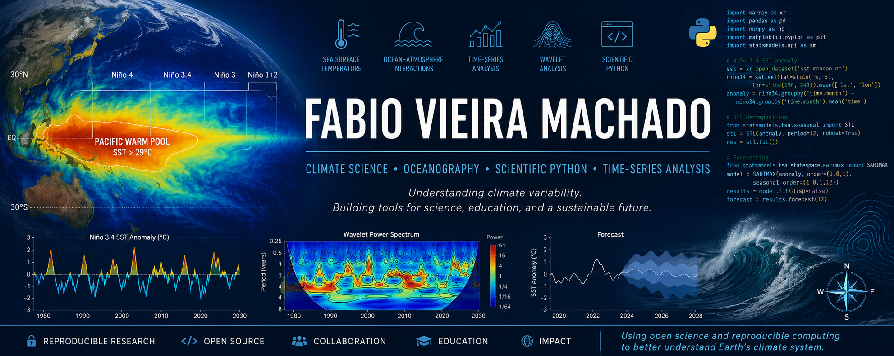

<h1 align="center">Fabio Vieira Machado</h1>

  <strong>Oceanographer | Hydrographic & Offshore Survey | Metocean | Scientific Data</strong> 

  <em>From measurements at sea to defensible scientific information.</em>

  <strong>20+ years spanning offshore survey operations, oceanographic observations, marine geophysics, subsea project support, scientific data analysis, and climate research.</strong>

  Based in New Zealand | Available for consulting, project-based, and fixed-term assignments nationally and internationally

  <a href="mailto:fvmachado.oceanscience@gmail.com">Email</a> ·

  <a href="https://orcid.org/0000-0003-0723-075X">ORCID</a> ·

  <a href="https://github.com/blackbeltbjj">GitHub</a>

---

## Contents

- [About Me](#about-me)
- [Core Professional Expertise](#core-professional-expertise)
- [Hydrographic AUV High Resolution & Reconnaissance Survey](#hydrographic-auv-high-resolution--reconnaissance-survey)
- [Oceanographic Instrumentation & Field Operations](#oceanographic-instrumentation--field-operations)
- [Offshore & Marine Survey Career](#offshore--marine-survey-career)
- [Scientific Computing & Environmental Data](#scientific-computing--environmental-data)
- [Research, Software & Reproducibility](#research-software--reproducibility)
- [Publications & Scientific Development](#publications--scientific-development)
- [Early Career & Research Foundation](#early-career--research-foundation)
- [Education & Training](#education--training)
- [Scientific Communication & Teaching](#scientific-communication--teaching)
- [Contact](#contact)

---

## About Me

### Professional Profile

I am an oceanographer, hydrographic survey professional, and scientific data specialist whose career bridges field operations and quantitative science.

My experience spans satellite oceanography and climate research, vessel-based hydrographic and marine-geophysical surveys, AUV/HUGIN and multibeam operations, acoustic positioning, oceanographic instrumentation, subsea project support, environmental observations, scientific computing, and reproducible ocean and climate research.

I have worked across the complete data lifecycle:

> **Sensor deployment → positioning → real-time acquisition → processing → QA/QC → analysis → interpretation → technical and scientific reporting**

> **Sensor deployment → positioning → data acquisition → Sensor recovery → processing → QA/QC → analysis → interpretation → technical and scientific reporting**

This combination allows me to understand environmental and survey data not simply as numerical products, but as measurements shaped by instrumentation, positioning, environmental conditions, acquisition procedures, and physical processes.

### Professional Snapshot

| Area | Profile |
|---|---|
| **Primary fields** | Physical Oceanography · Hydrographic Survey · Metocean · Environmental Data Science |
| **Operational background** | Offshore survey · AUV/HUGIN · Multibeam · Subsea positioning · Oceanographic instrumentation |
| **Scientific background** | Climate variability · ENSO · Pacific Warm Pool · Satellite oceanography · Time-series analysis |
| **Computational practice** | Python · MATLAB · NetCDF · Scientific QA/QC · Git/GitHub · Reproducible research |
| **Current base** | New Zealand; available for national and international projects |

### Work With Me

I am open to consulting, project-based, and fixed-term assignments where oceanographic knowledge, offshore experience, and quantitative data analysis can contribute to solving scientific or operational problems.

- Hydrographic and marine geophysical survey projects
- AUV/HUGIN and subsea survey operations
- Metocean data analysis
- Oceanographic observational programmes and environmental monitoring
- Hydrographic and oceanographic data QA/QC
- Scientific Python development and legacy scientific-data modernisation
- Climate and ocean time-series analysis
- Research software, reproducibility, and research-data management
- Technical and scientific reporting
- Scientific collaboration and education using authentic environmental observations

**New Zealand and international projects welcome.**

---

## Core Professional Expertise

### Professional Capabilities

| Hydrographic & Offshore Survey | Oceanography & Metocean | Scientific Data |
|---|---|---|
| Multibeam bathymetry | Physical oceanography | Python & MATLAB |
| AUV/HUGIN operations | Navier-Stokes Equation | Large environmental datasets |
| High-resolution AUV surveys | CTD/SVP/ADCP observations | NetCDF and gridded data |
| Seabed mapping | Oceanographic moorings | Statistics and time series |
| Side-scan sonar | Waves and tide | Fourier and wavelet analysis |
| Sub-bottom profiling | Satellite oceanography | Spatial analysis |
| Offshore/subsea positioning | SST, ENSO, climate variability | Scientific visualisation |
| Pipeline and as-built surveys | Environmental monitoring | Automated QA/QC |
| Dredging and backfilling | Marine observations | Reproducible workflows |

### Areas of Professional Interest

- **Survey and offshore:** Hydrographic survey, marine geophysics, underwater acoustics, subsea positioning, and AUV operations
- **Ocean and environment:** Physical oceanography, metocean, oceanographic instrumentation, ocean observations, and environmental monitoring
- **Climate science:** Climate variability, ENSO, Pacific Warm Pool, and satellite oceanography
- **Computing and data:** Scientific Python, environmental data science, time-series analysis, and spatial analysis
- **Research practice:** Reproducible research, scientific software, and research-data management

---

## Hydrographic AUV High Resolution and Reconnaissance Survey

Technical capability across hydrographic acquisition, offshore navigation, AUV operations, multibeam processing, marine geophysics, field QA/QC, and survey deliverables.

### Survey & Processing Software

`CARIS HIPS/SIPS` · `Kongsberg SIS` · `Hydromap Multibeam` · `Fledermaus` · `NavLab` · `Hypack/Hysweep`

### Acoustic Positioning & Subsea Navigation

`Kongsberg HiPAP` · `APOS` · `C-NAV DGPS` · `USBL` · `INS` · `DVL` · `AUV/HUGIN`

Experience with offshore navigation, subsea acoustic positioning, and autonomous survey operations, including AUV mission support and integration of navigation, positioning, and survey data. My background in physical oceanography and underwater acoustics provides additional understanding of environmental influences on sound propagation and subsea positioning.

### Multibeam, Sonar & Marine Geophysical Systems

`Kongsberg EM 2042` · `EM 1002` · `EM 712/712S` · `EM 710` · `EM 302` · `EM 3000`

`MBES` · `Side-Scan Sonar` · `Sub-Bottom Profiler` · `Marine Geophysics`

Applications have included high-resolution seabed mapping, pipeline and subsea-infrastructure surveys, route investigation, environmental surveys, and offshore project support.

### Survey Applications

#### Deep-Ocean AUV Hydrographic & Geophysical Survey Operations (>1,000 m)
_**Position: AUV Operator / MBES and Backscatter Data Processor**_

##### Aboard *R/V Northern Resolution* and *R/V Rig Supporter*

##### C-Surveyor II AUV HUGIN 3000 and 4500 AUV Systems & Payloads

- `200 kHz Kongsberg EM2000 multibeam` . `EdgeTech 2200/2205 dual-frequency SSS` . `EdgeTech DW106 Chirp SBP`
- `Teledyne RDI DVL` . `Kongsberg cNODE / HiPAP acoustic transponders operated through APOS` . `Ultra-Short BaseLine (USBL) acoustic tracking system`
- `Teledyne RDI DVL` . `Sea-Bird SBE 37/49 CTD` 
- `Kongsberg / Cathx still cameras for seabed imagery and photomosaicking`

##### Hull-Mounted Sonars & Vessel Geophysical Gear

- `12 kHz Kongsberg EM120` generated 191 beams per ping across a swath up to 5.5 times the water depth while simultaneously recording seabed backscatter during transit and reconnaissance phases.
- ` 3.5 kHz / SBP 120`  to map upper sediment layers across broad regional transects during transit and reconnaissance phases.
- `C-Nav dual-frequency DGPS` with satellite-based augmentation paired with a high-grade `Inertial Navigation System (INS)` / `Motion Reference Unit (MRU)` to compensate for vessel heave, pitch, roll, and yaw.
- 'Ultra-Short Baseline (USBL)' subsea acoustic transceiver (Kongsberg HiPAP system) tracked the subsea acoustic transponder on the AUV or towfish in real time relative to the ship's GPS coordinates.
- `Ring-laser gyro Inertial Measuring Unit (IMU)` aided by a `Doppler Velocity Log (DVL)` (which locks onto the seafloor to measure speed over ground), a high-precision `pressure depth sensor`, and a north-seeking `gyrocompass`.
- `Acoustic data link` to transmit sub-sampled sonar snippets, vehicle health diagnostics, and navigation residuals up to the ship's survey lab in real time, allowing surveyors to verify data quality and adjust mission waypoints mid-dive without recovering the vehicle.

Software: 

- `APOS` to control and monitor underwater acoustic positioning systems, primarily HiPAP and HPR systems
- `C&C HydroMap MBE` for navigation, acquisition, pre-processing, MBES and sensor-fusion workflows 
- `Kongsberg NavLab` for navigation simulation, analysis, and post-processing 
- `Seaterm` for direct serial/RS232 communication, status checks, and running direct instrument commands
- `SEASOFT V2` for data acquisition, conversion, and post-processing
- `SBE Data Processing` to convert raw hex/data files into engineering units, align CTD sensors, filter data, remove cell thermal mass effects, edit spikes, derive parameters (like salinity and TEOS-10 properties), and bin-average data

#### Offshore Geophysical & Reconnaissance Survey Operations (100–800 m)
_**AUV Operator / MBES Data Processor**_

- Reconnaissance supporting AUV deployments on continental shelf and upper-slope operations

##### Aboard *R/V Ocean Surveyor* and *R/V Andrew Charles* 

- `Hull-mounted Kongsberg Simrad EM 1002 / EM 710 MBES` . `EdgeTech CHIRP SBP` . `deep-towed EdgeTech SSS with armoured cable` and 
- `USBL/APOS/HiPAP acoustic positioning and cable-mounted transponders` 
- `Sea-Bird CTD casts` 
- `C-Nav GNSS`

Software:

- `C&C HydroMap MBE` for navigation and data acquisition and processing 
- `CARIS HIPS & SIPS` for MBE and Backscatter data processing
- `SonarWiz` for sonar visualisation
- `Seaterm` for direct serial/RS232 communication, status checks, and running direct instrument commands
- `SEASOFT V2` for data acquisition, conversion, and post-processing
- `SBE Data Processing` to convert raw hex/data files into engineering units, align CTD sensors, filter data, remove cell thermal mass effects, edit spikes, derive parameters (like salinity and TEOS-10 properties), and bin-average data

#### Coastal Hydrographic & Geophysical Survey Operations (<100 m)
_**Party Chief / Hydrographic Surveyor**_

- Shallow-water operations 

##### Aboard *R/V Coastal Surveyor* using hull-mounted configurations: 

- `Kongsberg Simrad EM 3002 / EM 3000 MBES (300 kHz)` 
- `EdgeTech 3100-P / 3200-XS CHIRP SBP with SB-216S (2–16 kHz) / SB-424 (4–24 kHz) transducers` 
- `EdgeTech 4100/4200 series SSS in mounted and towed configurations` 
- `Sea-Bird SBE 19plus V2 SeaCAT CTD casts for SVP` 
- `C-Nav GNSS/DGPS integrated with MRU`.  

Software: 

- `HydroMap` for navigation, acquisition and MBES processing 
- `SonarWiz` for SSS/SBP; 
- `Seaterm` for direct serial/RS232 communication, status checks, and running direct instrument commands
- `SEASOFT V2` for data acquisition, conversion, and post-processing
- `SBE Data Processing` to convert raw hex/data files into engineering units, align CTD sensors, filter data, remove cell thermal mass effects, edit spikes, derive parameters (like salinity and TEOS-10 properties), and bin-average data

---

## Metoceanographic Operations

### CTD Systems & Sensors — Sea-Bird Scientific

- SBE 19+ SeaCAT and SBE 19+ V2 SeaCAT
- SBE 3+ Temperature, SBE 4+ Conductivity, and SBE 5e Pump
- SBE 37 MicroCAT

#### Software and Operational Activities

- `Seasave V7` for real-time data acquisition and display during shipboard profiling
- `Seaterm` for direct serial/RS232 communication, status checks, and running direct instrument commands
- `SEASOFT V2` for data acquisition, conversion, and post-processing
- `SBE Data Processing` to convert raw hex/data files into engineering units, align CTD sensors, filter data, remove cell thermal mass effects, edit spikes, derive parameters (like salinity and TEOS-10 properties), and bin-average data

### ADCP Systems and Current meter 

- Teledyne RDI Workhorse Long Ranger 75 kHz; 
- Workhorse Sentinel 300, 600, and 1200 kHz; 
- Nortek Aquadopp Profiler/Current Meter

#### Software and Operational Activities

- `PlanADCP` for planning and configuration
- `WinADCP` to communicate and deploy the ADCP 
- `WinSC` for communication, deployment planning, testing, and data recovery with WorkHorse ADCP instruments 
- `BBTalk` to interface with Teledyne RDI hardware
- `Nortek AquaPro` 
- Compass calibration, instrument setup for data acquisition, deployment, and recovery 
- Data conversion, filtering, QA/QC, and interpretation of current profiles and directional waves

### Deep- & Ultra-Deep-Water Mooring & Metocean Operations (1,200–2,600 m)
_**Supervisor / Senior Oceanographer**_

- Deep- & Ultra-Deep-Water mooring deployments, recoveries and metocean surveys 

##### Aboard *R/V Emma McCall*: 

- SBE 37 MicroCAT CTD; 
- Nortek Aquadopp current meters; 
- Teledyne RDI Workhorse Long Ranger 75 kHz ADCP; 
- EdgeTech 8242XS deep-water acoustic releases. 

Fourmonth maintenance turnarounds covering recovery, biofouling cleaning, batteries, data retrieval and redeployment. 

- Vessel-mounted Teledyne RDI Ocean Surveyor ADCP, 
- full-depth SBE 19plus (4 Hz) SeaCAT CTD casts and 
- C-Nav GNSS. 

Maintained contract-specified geodetic coordinates and datums in operational logs.  
Software: 

- Teledyne RDI VmDas 
- WinSC/WinADCP
- PlanADCP
- BBTalk  
- Nortek AquaPro  
- Sea-Bird Seaterm, SeaSave, SBE Data Processing 

### Nearshore & Shore Approach Metocean Mooring Operations (20–25 m)
_**Supervisor / Senior Oceanographer**_

- Shallow-Water mooring deployments and recoveries 

#####  Aboard local *ships of opportunity*: 

- Bottom-mounted Teledyne RDI Workhorse Sentinel 600 kHz / Sentinel V 500 kHz ADCPs with wave-measurement capabilities; 
- Acoustic releases and pop-up buoy recovery. 
- C-Nav GNSS. 

Monthly maintenance turnarounds covering recovery, biofouling cleaning, battery replacement, data retrieval,  QC and redeployment. 
Maintained contract-specified geodetic coordinates and datums in operational logs.  

Software: 

-  WinSC/WinADCP
-  PlanADCP 
-  BBTalk 

### Multidisciplinary Hydrographic, Mooring & Environmental Baseline Surveys
**_Supervisor / Senior Oceanographer_** 

- Hydrographic reconnaissance survey and marine environmental monitoring 

#####  Aboard R/V Andrew Charles**:

- Niskin and Nansen bottles for nutrients, pH and dissolved oxygen using Winkler titration 
- Plankton net tows
- Boxcorer sediment sampling for benthic and geochemical assessments  
- Same as **Reconnaissance Survey Operations (100–800 m)**

---

## Oceanographic Instrumentation & Field Operations

#### Operational experience

- ADCP: Instrument configuration, data acquisition and analysis
- Current profiling and oceanographic mooring installation and recovery
- Wave/current observations, environmental monitoring, and QA/QC
- CTD moorings and vertical profiles: Instrument setup, data acquisition and analysis
- Multi-bottle rosette systems

<table>
  <tr>
    <td width="27%" align="left" valign="top">
      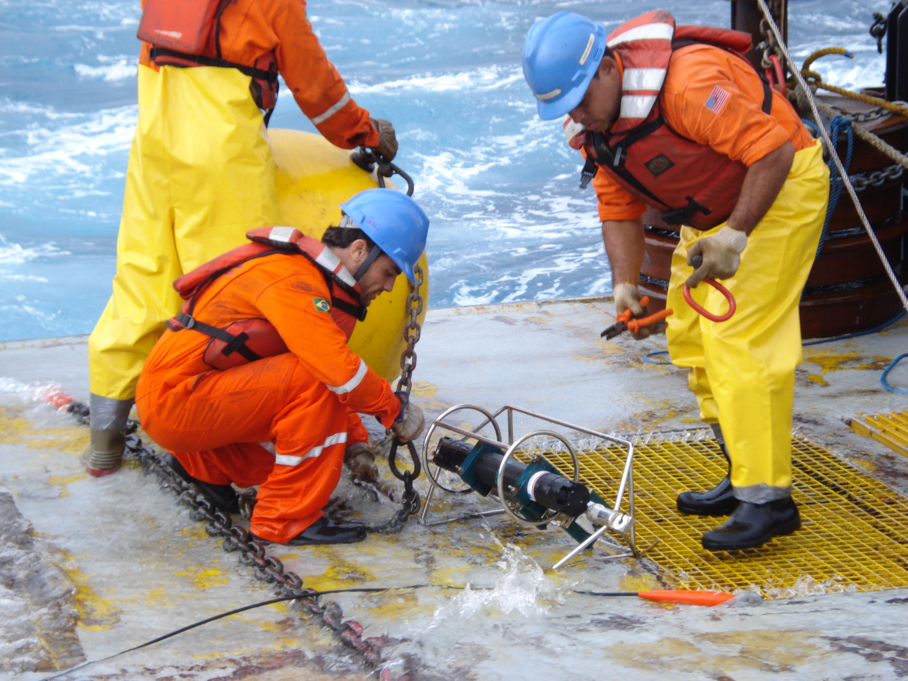
       
      <em>Preparing an Aquadopp current meter and mooring line during offshore field operations.</em>
    </td>
    <td width="43%" valign="top">
      Direct field experience includes instrument preparation, mooring-line assembly, vessel-based deployment and recovery, acquisition support, data QA/QC, and assessment of measurements within their operational and environmental context.
    </td>
  </tr>
</table>

#### ADCP Field Operations — Shore Approach

Operational footage documenting vessel-based ADCP deployment and recovery during shore-approach survey work.

<table>
  <tr>
    <td width="34%" align="left" valign="top">
      <a href="videos/adcp-deployment-shore-approach.mp4?raw=1">
        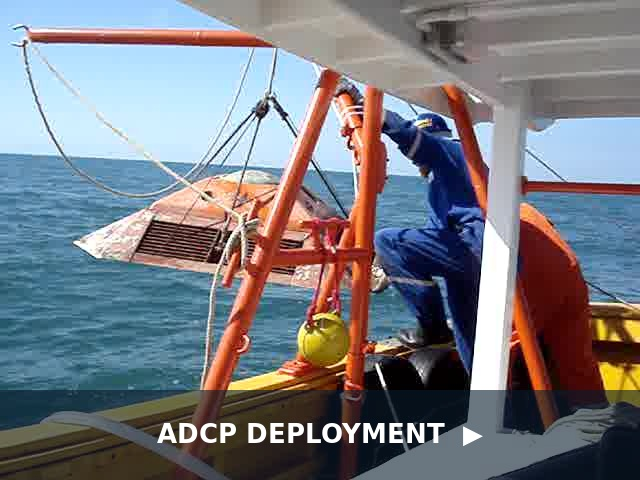
      </a>
       
      <strong>ADCP Deployment</strong> 
      Click the image to watch the operational footage.
    </td>
    <td width="34%" align="right" valign="top">
      <a href="videos/adcp-recovery-shore-approach.mp4?raw=1">
        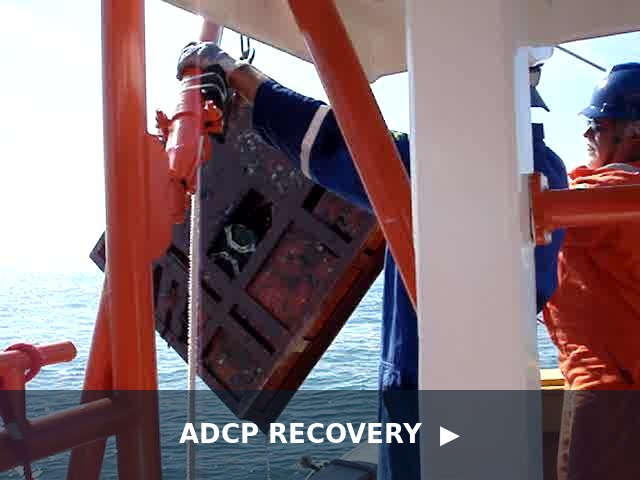
      </a>
       
      <strong>ADCP Recovery</strong> 
      Click the image to watch the operational footage.
    </td>
  </tr>
</table>

### Marine Sampling & Observational Systems

Multi-bottle rosette systems · Nansen bottles · Plankton nets · Box-core sediment samplers · Oceanographic moorings · Wave buoys · CTD/SVP casts · Current-meter deployments

Working directly with instruments and field observations provides important context when assessing the quality, uncertainty, and physical meaning of environmental datasets.

---

## Offshore & Marine Survey Career

My offshore career progressed from navigation, processing, and survey-support responsibilities to hydrographic surveying, Offshore Operations Party Chief responsibilities, metocean operations, AUV/HUGIN and multibeam operations, marine-geophysical real-time data analysis, senior oceanographic work, field supervision, client-side technical support, and project coordination.

### C&C Technologies do Brasil

#### Hydrographic, AUV, and metocean responsibilities

- Hydrographic and marine-geophysical surveys
- Offshore Operations Party Chief responsibilities
- AUV/HUGIN high-resolution survey operations
- HiPAP acoustic positioning and offshore navigation
- Multibeam acquisition, processing, and real-time geophysical analysis
- Metocean services and physical-oceanographic observations
- ADCP/DVL data, environmental-programme support, field QA/QC, and procedures

### Petrobras

#### Marine survey and project responsibilities

- Marine survey and oceanographic work packages
- Bathymetric, positioning, and environmental datasets
- Vessel and contractor activities
- HSE, quality control, procedures, and risk analysis
- Technical reporting and multidisciplinary project coordination

<table>
  <tr>
    <td width="27%" align="center" valign="top">
      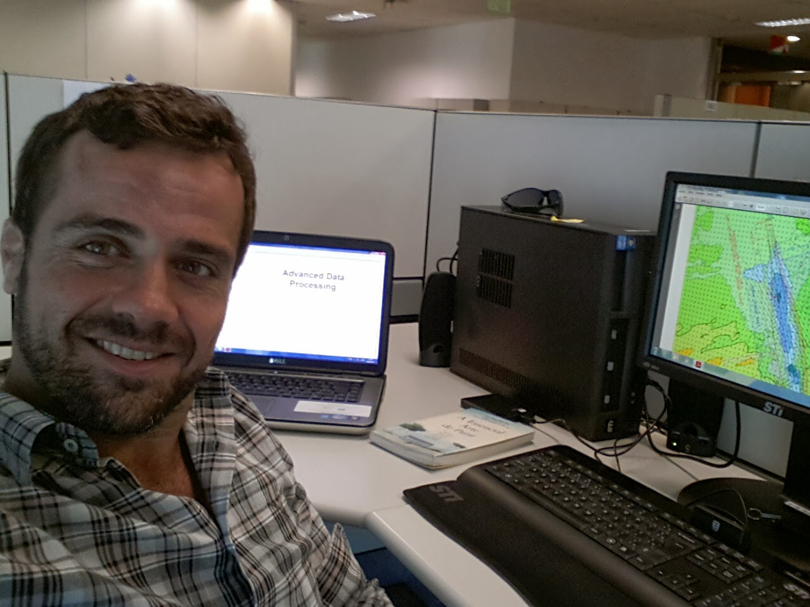
       
      <em>At Petrobras office reviewing technical report.</em>
    </td>
    <td width="43%" valign="top">
      Assessed bathymetric, positioning and environmental data for shore approaches, dredging and backfilling; reviewed
procedures, and risk assessments and reports.
    </td>
  </tr>
</table>

### Subsea Consult

#### Subsea survey and client-support responsibilities

- Pipeline-route and subsea-infrastructure surveys
- Pre-lay, post-lay, as-built, freespan, and shore-approach work
- Dredging and backfilling projects
- AUV high-resolution geophysical surveys
- Oceanographic moorings and ADCP deployments
- Client representation, technical reporting, and field support

---

## Scientific Computing & Environmental Data

### Languages & Environments

`Python` · `MATLAB` · `Unix/Linux` · `Windows` · `Git` · `GitHub` · `Jupyter` · `VS Code`

### Python Scientific Stack

`NumPy` · `pandas` · `SciPy` · `xarray` · `Statsmodels` · `Matplotlib` · `PyWavelets`

### Analytical Capabilities

- Large multidimensional ocean and climate datasets
- NetCDF and gridded geophysical observations
- Satellite sea-surface temperature and geospatial analysis
- Statistical, spatial, and time-series analysis
- Spherical geometry and connected-component analysis
- Fourier, wavelet, Welch power spectral density, and continuous wavelet transforms
- STL decomposition and robust trend estimation
- Occurrence and persistence analysis
- Scientific visualisation and automated QA/QC
- Scientific provenance and reproducible computational workflows

---

## Research, Software & Reproducibility

My current research links scientific manuscripts with version-controlled computational workflows, audited software releases, and persistent archival records where available.

### Featured Research Portfolio

| Research programme | Scientific focus | Software and archive | Status |
|---|---|---|---|
| **PWP threshold definition and centroid geometry** | Effects of 28.0, 28.5, and 29.0 °C definitions on warm-pool geometry and variability | [OSAF-PWP](https://github.com/blackbeltbjj/OSAF-PWP) · [Sensitivity repository](https://github.com/blackbeltbjj/pwp-threshold-centroid-sensitivity) · Zenodo DOIs | JTECH submission, 18 Aug 2026 |
| **PWP28 area expansion and spatial organisation** | Daily area, trend, seasonality, variability, connectivity, and fragmentation | Private reproducibility repository during review | RBMet submission, 28 Aug 2026 |
| **PWP28 time-series analysis and physics education** | Daily SST-derived area, trends, seasonality, time-series diagnostics and educational applications | [PWP28-Physics-Education](https://github.com/blackbeltbjj/PWP28-Physics-Education) · [Zenodo DOI](https://doi.org/10.5281/zenodo.23584235) | RBEF submitted 23 Oct 2026 (RBEF-2026-0506); archived release v1.0.0 |
| **Largest connected Pacific Warm Pool** | Long-term expansion and increasing spatial coherence across SST thresholds | [pwp-lcc-spatial-coherence](https://github.com/blackbeltbjj/pwp-lcc-spatial-coherence) · [Zenodo](https://doi.org/10.5281/zenodo.22499662) | Journal of Climate submission, 6 Sep 2026 |
| **Convective enrichment** | Threshold-dependent relationship between warm-pool structure and deep convection | [pwp-convective-enrichment](https://github.com/blackbeltbjj/pwp-convective-enrichment) · [Zenodo](https://doi.org/10.5281/zenodo.22857851) | Theoretical and Applied Climatology submission, Sep 2026 |

### Pacific Warm Pool — Threshold Definition & Centroid Geometry

#### Manuscript and scope

**Manuscript:** **Defining the Pacific Warm Pool: Threshold Dependence of Centroid Geometry and Robustness of Interannual Variance Modulation**  

**Journal:** Journal of Atmospheric and Oceanic Technology  

**Status:** Submitted 18 August 2026

The study examines how 28.0, 28.5, and 29.0 °C SST definitions alter diagnosed Pacific Warm Pool area, centroid position, spatial geometry, and displacement, while assessing the robustness of interannual variance modulation across thresholds.

#### Scientific software and data

- [OSAF-PWP](https://github.com/blackbeltbjj/OSAF-PWP), v1.0.0 — [Zenodo DOI](https://doi.org/10.5281/zenodo.21964951)
- [pwp-threshold-centroid-sensitivity](https://github.com/blackbeltbjj/pwp-threshold-centroid-sensitivity), v1.0.0 — [Zenodo DOI](https://doi.org/10.5281/zenodo.21964955)
- Derived Data v1.0.0 — [Zenodo DOI](https://doi.org/10.5281/zenodo.21976955)

#### Methods

Spherical geometry · Physical-area weighting · Threshold sensitivity · Centroid analysis · Connectivity · Wavelets · Occurrence and persistence

  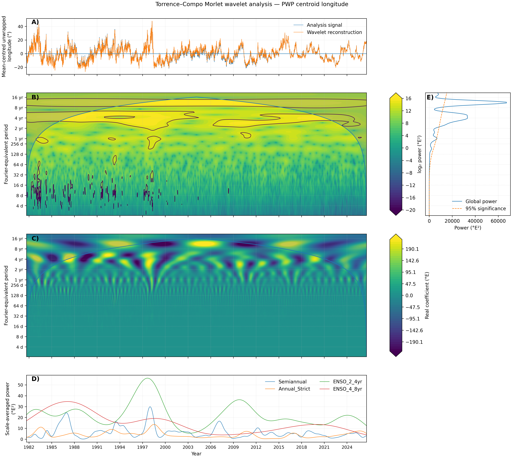

### Pacific Warm Pool — 28 °C Area Expansion & Spatial Organisation

#### Manuscript and scope

**Manuscript:** **Variability, Expansion and Spatial Organisation of the 28 °C Pacific Warm Pool from 1981 to 2026**  

**Journal:** Revista Brasileira de Meteorologia  

**Status:** Submitted 28 August 2026; anonymous review

The study examines daily PWP28 area, long-term expansion, seasonality, temporal variability, and spatial connectivity using NOAA OISST v2.1. The supporting repository is maintained privately during review.

#### Methods and reproducibility

Daily area · Long-term trend · Seasonal cycle · Interannual variability · Time-frequency analysis · Connectivity and fragmentation · Scientific QA/QC

  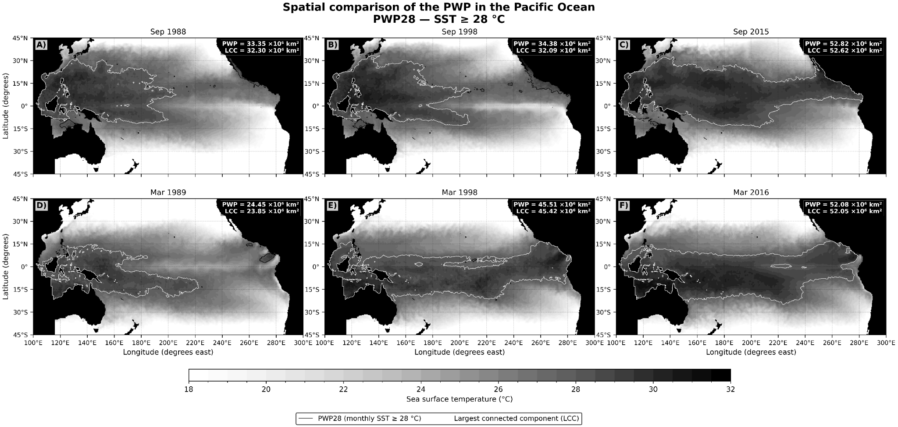

### Pacific Warm Pool — Time-Series Analysis & Climate Education

#### Manuscript and scope

**Research focus:** Pacific Warm Pool area variability and the teaching of time-series analysis using authentic climate observations

**Journal:** Revista Brasileira de Ensino de Física (RBEF)

**Status:** Submitted 23 October 2026 (RBEF-2026-0506); reproducibility release v1.0.0 archived October 2026

This work follows daily sea-surface temperature observations through the definition of the 28 °C Pacific Warm Pool, spherical area calculations, and statistical analysis. It connects spatial oceanographic observations with long-term trends, seasonal variability, residual diagnostics, and forecasting, providing a data-driven example for physics and statistics education.

#### Scientific software and archive

- **Software and derived data:** [PWP28-Physics-Education](https://github.com/blackbeltbjj/PWP28-Physics-Education)
- **Release:** [v1.0.0](https://github.com/blackbeltbjj/PWP28-Physics-Education/releases/tag/v1.0.0)
- **Archive:** [Zenodo DOI: 10.5281/zenodo.23584235](https://doi.org/10.5281/zenodo.23584235)
- **Reproducibility:** 17 numerical output tables matched the original results; Figures 2–9 were regenerated. Full spatial reproduction of Figure 1 requires the original gridded SST data and Pacific-domain mask.

#### Methods

Spherical geometry · NOAA OISST v2.1 · Daily area · Trend estimation · Seasonal climatology · Residual diagnostics · Autocorrelation · Hindcast and forecasting · Science education

  

  
  

### Pacific Warm Pool — Largest Connected Component

#### Manuscript and scope

**Manuscript:** **Expansion and Increasing Spatial Coherence of the Largest Connected Pacific Warm Pool, 1981–2026**  

**Journal:** Journal of Climate  

**Status:** Submitted 6 September 2026

The study investigates the long-term evolution of the largest spatially connected warm-water component across multiple SST thresholds, integrating trends, seasonality, spectral variability, spatial occurrence, and connectivity diagnostics.

#### Scientific software and archive

- **Scientific software:** [pwp-lcc-spatial-coherence](https://github.com/blackbeltbjj/pwp-lcc-spatial-coherence)
- **Release:** v1.0.0 — Scientific/Reproducibility Freeze
- **Archive:** [Zenodo DOI](https://doi.org/10.5281/zenodo.22499662)

#### Methods

Connected-component analysis · Theil–Sen trends · STL · Welch power spectra · Continuous wavelets · Occurrence and persistence

  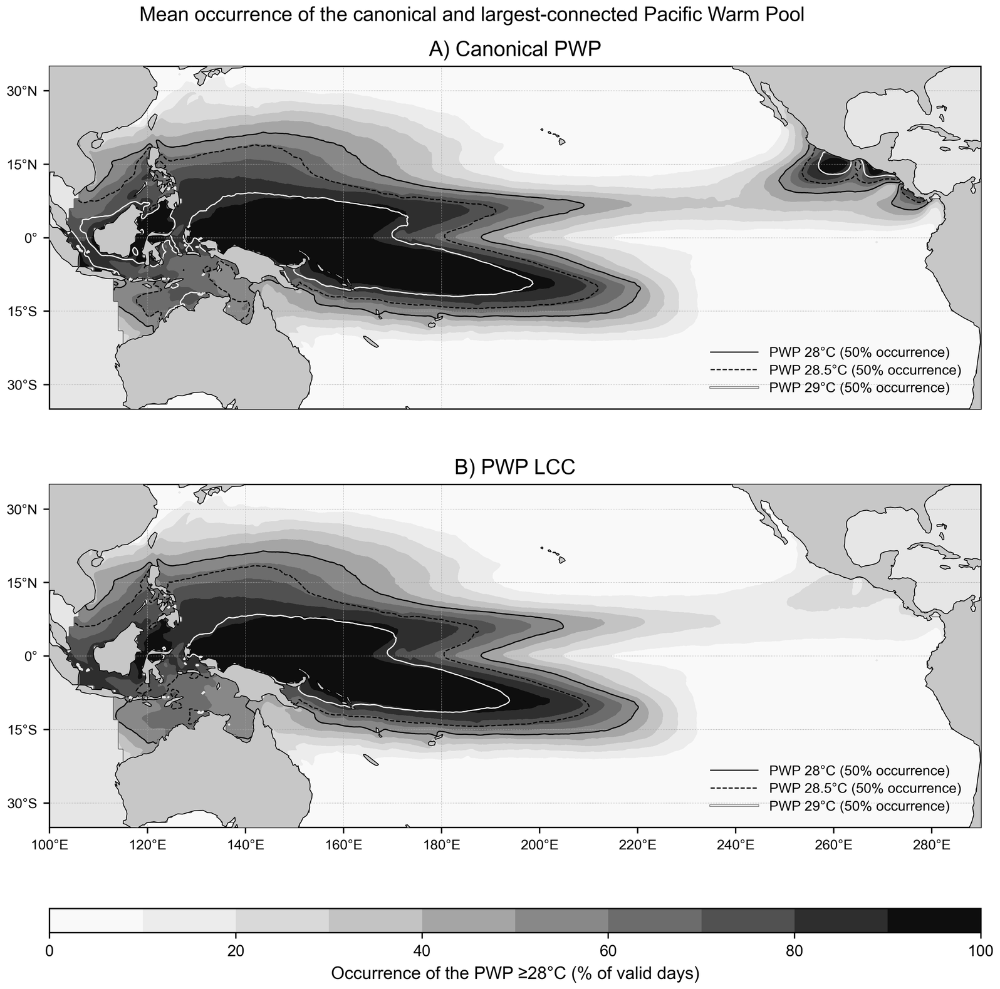

### Pacific Warm Pool — Convective Enrichment

#### Manuscript and scope

**Manuscript:** **Threshold-Dependent Convective Enrichment of the Pacific Warm Pool, 1982–2025**  

**Journal:** Theoretical and Applied Climatology  

**Status:** Submitted September 2026

The study examines how SST threshold choice affects the diagnosed relationship between Pacific Warm Pool structure and deep convection over 1982–2025, using NOAA OISST v2.1 and NOAA Daily OLR CDR v2.0.

#### Scientific software and archive

- **Scientific software:** [pwp-convective-enrichment](https://github.com/blackbeltbjj/pwp-convective-enrichment)
- **Release:** v1.0.0 — Reproducibility Package
- **Archive:** [Zenodo DOI](https://doi.org/10.5281/zenodo.22857851)

#### Methods

SST-threshold analysis · Deep-convection diagnostics · OLR · Connected-component analysis · Equatorial geometry · ENSO relationships

  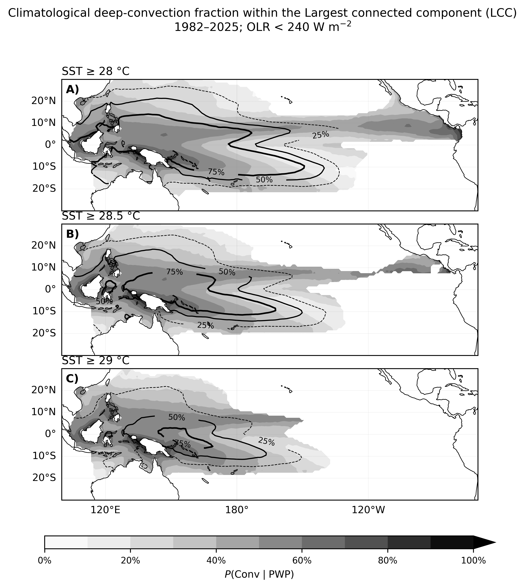

### Southern Ocean Observational Data

#### Project overview

At the University of Auckland Centre for eResearch, I worked with irregularly sampled Southern Ocean observations, including Argo profiling-float and animal-borne observations, supporting the development of regularly gridded observational fields and climatological products.

- **Repository:** [argo](https://github.com/blackbeltbjj/argo)
- **Methods:** Argo profiling floats · Animal-borne observations · Irregular sampling · Filtering · Gridding · Climatological products

#### Climatological products

<strong>Climatological Salinity Field</strong> Resolution: 1° × 1°

  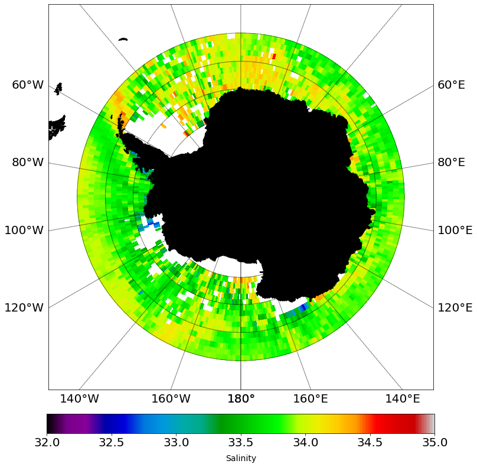

<strong>Climatological Temperature Field</strong> Resolution: 1° × 1°

  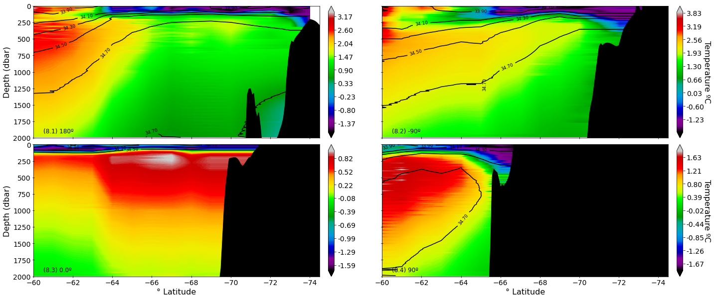

### Reproducibility Practice

My current scientific workflows incorporate:

- Version-controlled source code and explicit scientific configuration
- Environment and dependency records
- Input and output inventories
- Automated quality control and numerical validation
- Metadata capture and SHA-256 integrity manifests
- Tagged software releases and persistent archival records
- Documented provenance from observations to publication products

---

### From Early Satellite Oceanography to Reproducible Scientific Software

My Pacific climate research began during undergraduate work in Physical Oceanography. In 1999–2000, a FAPERJ-supported project at the State University of Rio de Janeiro involved developing C++ and Fortran software to process NOAA/AVHRR sea-surface temperature observations, calculate Pacific Warm Pool area and centroid, analyse time series, generate scientific graphics, and communicate results through reports and seminars.

Today, related scientific questions are being revisited using daily high-resolution satellite observations, Python, spherical geometry, spatial-connectivity analysis, modern time-frequency methods, version control, and reproducible research infrastructure.

> **Satellite SST and C++/Fortran → PWP/ENSO research → Offshore oceanography → AUV/HUGIN and multibeam → Subsea projects → Southern Ocean data → Python and reproducible climate science**

---

## Early Career & Research Foundation

### Climate Group — CPTEC/INPE

#### Research Internship | 1999

Early experience within the Climate Group at Brazil's Center for Weather Forecasting and Climate Studies, under the supervision of Dr. José Antonio Marengo Orsini.

### Physical Oceanography & Satellite Data — UERJ/FAPERJ

#### Undergraduate Research | 1999–2000

Worked on the FAPERJ-supported project **A Mathematical Model for the El Niño Phenomenon**, using NOAA/AVHRR satellite SST observations, C++ and Fortran, Pacific Warm Pool area and centroid calculations, time-series analysis, scientific graphics, technical reports, and research presentations.

### Brazilian Navy — IEAPM

#### Oceanographic Data Processing Internship | 2000

Worked with physical-oceanographic data processing and computational routines associated with the marine environment and underwater sound propagation at the Almirante Paulo Moreira Institute of Sea Studies.

---

## Education & Training

### Academic Education

#### MSc — Meteorology / Atmospheric Sciences

**University of São Paulo — USP, Brazil**  

Advanced postgraduate study in atmospheric and climate sciences, including atmosphere and ocean dynamics, geophysical fluid dynamics, climate variability, micrometeorology and turbulence, and ocean–atmosphere processes. **NZQA assessed equivalent: New Zealand Level 9 Master's degree.**

#### Postgraduate Study — Ocean & Earth Dynamics

**Fluminense Federal University — UFF, Brazil**  

Advanced study related to ocean and Earth-system dynamics,  including underwater acoustic, and marine geophysical processes.

#### BSc — Oceanography

**State University of Rio de Janeiro — UERJ, Brazil | 2002**  

Professional education across physical, chemical, biological, and geological oceanography, hydrography, marine observations and data analysis, meteorology and climatology, and environmental sciences.

### Scientific & Quantitative Foundation

- **Ocean and atmosphere:** Geophysical Fluid Dynamics, wind waves, physics of the ocean, atmospheric dynamics, micrometeorology, turbulence, and remote sensing
- **Ocean sciences:** Physical, chemical, biological, and geological oceanography; marine geophysics; hydrography; water-mass analysis; astronomy and navigation
- **Coastal and marine sciences:** Estuarine oceanography, marine pollution, coastal processes, ecology, hydrodynamic modelling, tides, and cartography
- **Climate sciences:** Climatology, climate variability, Meteorology, Oceanography, Ocean–Atmosphere interaction, stochastic processes, and observational methods
- **Mathematics and statistics:** Advanced calculus, partial differential equations, Fluid dynamics, spherical trigonometry, statistics, time-series analysis, Fourier Transform, Continuous Wavelet Transform, and data processing

### Additional Postgraduate Study Since 2018 - New Zealand

- **Writing Research Reports (Academic Writing)** - University of Auckland, Certificate of Proficiency in Science, 2019 | 15 credits | Grade: B+
- **Mana Tangata: Education in Aotearoa** - Postgraduate Diploma in Secondary Teaching coursework, 2024 | 15 credits | Grade: B-
- **Practising Excellence 1: Curriculum & Pedagogy** - Postgraduate Diploma in Secondary Teaching coursework, 2024 | 15 credits | Grade: B-
- **Teaching and Digital Education** - Massey University, Postgraduate Diploma in Education, 2026 | 30 credits | Grade: B

**Completed postgraduate coursework since 2018: 75 credits.**

### Additional Postgraduate Study between 2015 to 2017

- **Ocean models** - Federal University of Rio de janeiro, PhD in Oceanic and Coastal Engineering, 2015 | 30 credits | Grade: A
- **Oceanographic Instrumentation** - Federal University of Rio de janeiro, PhD in Oceanic and Coastal Engineering, 2016 | 30 credits | Grade: A
- **Topics in Physical oceanography** - Federal University of Rio de janeiro, PhD in Oceanic and Coastal Engineering, 2017 | 30 credits | Grade: B

### Advanced Scientific & Professional Training

- CARIS HIPS — Hydrographic data-processing training (2011)
- Sea-Bird CTD — Instrument operation and data processing (2011)
- Instability Problems — National laboratory for Computer Sciences LNCC (2003)
- Navier-Stokes Equation and turbulence — National laboratory for Computer Sciences LNCC (2003)
- Estuarine Oceanography — Oceanographic Institute, University of São Paulo(2002)
- Physical Oceanography of the South Atlantic — Federal University of Rio Grande (2001)
- Summer School in Geophysics — National Observatory / Ministry of Science and Technology, Brazil (2002)
- Mid-Ocean Ridge Geophysics — LAGEMAR/UFF and Université de Bretagne Occidentale (1998)
- Satellite Oceanography (1999)

---

## Publications & Scientific Development

### Peer-Reviewed Journal Articles

1. Machado, F. V., & d'Avila, V. A. (2014). O centroide da piscina de água quente do Pacífico como um indicador dos fenômenos El Niño e La Niña [The centroid of the Pacific warm pool as an indicator of El Niño and La Niña phenomena]. *Revista Brasileira de Meteorologia*, *29*(3), 443–456. https://doi.org
2. Machado, F. V., & d'Avila, V. A. (2006). A trajetória e a área da piscina de água quente do Pacífico [The trajectory and area of the Pacific warm pool]. *Revista Brasileira de Meteorologia*, *21*(2), 161–169.

### Technical & Institutional Reports

1. Machado, F. V. (2019). Evenly spaced observation fields from irregularly sampled data in the Southern Ocean. In *Centre for eResearch Annual Report 2019* (pp. 50–55). The University of Auckland.

### Full Papers in Conference Proceedings

1. Machado, F. V., Soares, J. R., & d'Avila, V. A. (2004, August 29–September 3). Resultados preliminares do estudo da variabilidade espacial e temporal da piscina de água quente do Oceano Pacífico [Preliminary results of the study on the spatial and temporal variability of the Pacific Ocean warm pool] [Oral presentation]. In *Anais do XIII Congresso Brasileiro de Meteorologia* [Proceedings of the 13th Brazilian Congress of Meteorology] (Marina Park Hotel, Fortaleza, CE, Brazil). Sociedade Brasileira de Meteorologia.
2. Machado, F. V., & d'Avila, V. A. (2004, August 29–September 3). Programa para a visualização da grade de temperatura superficial dos oceanos e edição de máscaras numéricas continentais [Program for visualizing the sea surface temperature grid and editing continental numerical masks] [Poster presentation]. In *Anais do XIII Congresso Brasileiro de Meteorologia* [Proceedings of the 13th Brazilian Congress of Meteorology] (Marina Park Hotel, Fortaleza, CE, Brazil). Sociedade Brasileira de Meteorologia.

### Conference Abstracts & Presentations

1. Machado, F. V., & d'Avila, V. A. (2005, May 16–20). *Variabilidade espaço-temporal da piscina de água quente do Pacífico. Parte 1: Definição das variáveis* [Spatiotemporal variability of the Pacific warm pool. Part 1: Definition of variables] [Oral presentation]. XI Congreso Latinoamericano de Ciencias del Mar (COLACMAR) & XXV Congreso de Ciencias del Mar de Chile, Viña del Mar, Chile.
2. Machado, F. V., & d'Avila, V. A. (2005, May 16–20). *Variabilidade em tempo-escala da piscina de água quente do Pacífico. Parte III: A componente longitudinal* [Time-scale variability of the Pacific warm pool. Part III: The longitudinal component] [Oral presentation]. XI Congreso Latinoamericano de Ciencias del Mar (COLACMAR) & XXV Congreso de Ciencias del Mar de Chile, Viña del Mar, Chile.
3. Machado, F. V., & d'Avila, V. A. (2004, October 10–15). *The space and time variabilities of the latitudinal component of the Pacific warm pool* [Abstract presentation]. I Congresso Brasileiro de Oceanografia: As instituições e o mercado frente à evolução tecnológica [1st Brazilian Congress of Oceanography], Universidade do Vale do Itajaí, Itajaí, SC, Brazil.
4. Machado, F. V., d'Avila, V. A., & Soares, J. R. (2004, June 21–25). *The centroid motion of the Pacific warm pool described by spherical coordinates* [Abstract presentation]. 1st International CLIVAR Science Conference, Baltimore, MD, United States. (Abstract No. OC-67).
5. Machado, F. V., & d'Avila, V. A. (2004, May 16–20). *The visualization of the variabilities of the Pacific warm pool and SST: A new code* [Poster presentation]. IV Encontro Regional de Matemática Aplicada e Computacional, I Workshop sobre Simulação e Análise de Sistemas Complexos & III Escola Brasileira de Ciências Emergentes (IV ERMAC + WSASC & EBCE), Maresias Beach Hotel, São Sebastião, SP, Brazil.
6. d'Avila, V. A., Machado, F. V., & Soares, J. R. (2003, October 27–31). *Rotina para acesso aos dados históricos para a temperatura da superfície do mar* [Routine for accessing historical sea surface temperature data] [Abstract presentation]. XV Semana Nacional de Oceanografia [15th National Oceanography Week], Universidade do Vale do Itajaí, Itajaí, SC, Brazil.
7. Soares, J. R., Oliveira, A. P., Barcelar, S. A., Espinosa, A. M., & Machado, F. V. (2003). *Resultados preliminares da campanha de medidas do projeto FluTuA* [Preliminary results of the measurement campaign of the FluTuA project] [Abstract presentation]. V Seminário de Ondas, Marés e Engenharia Oceânica [5th Seminar on Waves, Tides, and Ocean Engineering], Arraial do Cabo, RJ, Brazil.
8. Machado, F. V., & d'Avila, V. A. (2002, August 26–30). *Definição de máscaras numéricas para a grade de temperatura superficial dos oceanos* [Definition of numerical masks for the sea surface temperature grid] [Abstract presentation]. I Simpósio Brasileiro de Oceanografia [1st Brazilian Symposium on Oceanography], Instituto Oceanográfico da Universidade de São Paulo, São Paulo, SP, Brazil.
9. Machado, F. V., & d'Avila, V. A. (2002, August 26–30). *Rotina para acesso aos dados do NOAA para a temperatura superficial dos oceanos* [Routine for accessing NOAA sea surface temperature data] [Abstract presentation]. I Simpósio Brasileiro de Oceanografia [1st Brazilian Symposium on Oceanography], Instituto Oceanográfico da Universidade de São Paulo, São Paulo, SP, Brazil.
10. d'Avila, V. A., & Machado, F. V. (2002, August 26–30). *Um diagrama de fase para descrição do El Niño* [A phase diagram for describing El Niño] [Abstract presentation]. I Simpósio Brasileiro de Oceanografia [1st Brazilian Symposium on Oceanography], Instituto Oceanográfico da Universidade de São Paulo, São Paulo, SP, Brazil.
11. d'Avila, V. A., & Machado, F. V. (2002, August 26–30). *Um modelo para mudanças globais e El Niño* [A model for global changes and El Niño] [Abstract presentation]. I Simpósio Brasileiro de Oceanografia [1st Brazilian Symposium on Oceanography], Instituto Oceanográfico da Universidade de São Paulo, São Paulo, SP, Brazil.

---

## Scientific & Research Communication

### Conference Oral Presentations

1. Machado, F. V., & d'Avila, V. A. (2004, October 10–15). *The space and time variabilities of the longitudinal component of the Western Pacific Warm Pool* [Oral presentation]. I Brazilian Congress of Oceanography, Universidade do Vale do Itajaí, Itajaí, SC, Brazil.

2. Machado, F. V., Soares, J. R., & d'Avila, V. A. (2004, August 29–September 3). *Preliminary results on the space-time variability study of the Western Pacific Warm Pool* [Oral presentation]. XIII Brazilian Congress of Meteorology, Marina Park Hotel, Fortaleza, CE, Brazil.

### Invited Talks & Departmental Seminars

1. Machado, F. V. (2005, October 6). *The zonal displacement of the Western Pacific Warm Pool: El Niño phenomenon* [Seminar presentation]. Department of Atmospheric Sciences, Institute of Astronomy, Geophysics and Atmospheric Sciences, University of São Paulo (IAG-USP), São Paulo, SP, Brazil.

2. Machado, F. V. (2005, April 8). *Aspectos oceanográficos e meteorológicos do evento ENOS de 1997–98* [Oceanographic and meteorological aspects of the 1997–98 ENSO event] [Seminar presentation]. Department of Atmospheric Sciences (DCA), Institute of Astronomy, Geophysics and Atmospheric Sciences, University of São Paulo (IAG-USP), São Paulo, SP, Brazil.

3. Machado, F. V. (2004, November 11). *A componente longitudinal do centroide da piscina quente do Pacífico como um indicador do fenômeno ENOS* [The longitudinal component of the Pacific warm pool centroid as an indicator of the ENSO phenomenon] [Invited seminar]. Graduate Program in Applied Computing (CAP), Associated Laboratory for Computing and Applied Mathematics (LAC), National Institute for Space Research (INPE), São José dos Campos, SP, Brazil.

4. Machado, F. V. (2004, November 5). *Aspectos oceanográficos no Pacífico Tropical e o monitoramento do fenômeno ENOS* [Oceanographic aspects in the Tropical Pacific and the monitoring of the ENSO phenomenon] [Seminar presentation]. Department of Atmospheric Sciences (DCA), Institute of Astronomy, Geophysics and Atmospheric Sciences, University of São Paulo (IAG-USP), São Paulo, SP, Brazil.

---

## Teaching Experience

### Higher Education

* **Graduate Teaching Assistant — MARINE 202** | *Mar 2019 – Jul 2019*  
  School of Environment, Faculty of Science, The University of Auckland, Auckland, New Zealand.  
  * Facilitated laboratory sessions, field trips, and course preparation for *MARINE 202* (46 hours total) under Head of School Prof. David Hayward.

* **Graduate Teaching Fellow — Teaching Improvement Program (PAE)** | *Feb 2004 – Jun 2004*  
  Department of Atmospheric Sciences, Institute of Astronomy, Geophysics and Atmospheric Sciences, University of São Paulo (IAG-USP), São Paulo, SP, Brazil.  
  * Supported graduate-level instruction in Meteorology (6 hours/week) under the supervision of Prof. Dr. Jacyra Ramos Soares.

* **Undergraduate Teaching Assistant — Physical Oceanography I & II** | *Apr 2001 – Dec 2001*  
  Institute of Geosciences (IGEO), Rio de Janeiro State University (UERJ), Rio de Janeiro, RJ, Brazil.  
  * Assisted undergraduate students and laboratory activities in *Physical Oceanography I and II* (20 hours/week) under the supervision of Prof. Luiz Carlos Ferreira da Silva.

### Secondary Education (Aotearoa New Zealand)

* **Mathematics Teacher (0.6 FTE) & Mathematics Learning Support Tutor** | *Mar 2026 – Dec 2026*  
  Huanui College, Whangārei, Northland, New Zealand.  
  * **Mathematics Teacher (Fixed-Term, 0.6 FTE):** Delivered secondary Mathematics curriculum instruction (24 hours/week), tracked student progress data, and contributed to pastoral care and co-curricular school life (2 Mar 2026 – 11 Dec 2026).
  * **Key Learning Support Tutor (Fixed-Term):** Provided targeted one-on-one Mathematics tutoring (4 hours/week) alongside core teaching duties (2 Mar 2026 – 25 Sep 2026).

* **Physics & Science Teacher (Fixed-Term, 0.6 FTE)** | *Mar 2025 – [End Month 2025]*  
  Whangārei Boys' High School, Whangārei, Northland, New Zealand.  
  * Taught Senior Physics (Year 12 / NCEA Level 2) and Junior Science (15 contact hours/week) under a Limited Authority to Teach (LAT), managing lesson delivery, practical laboratory work, and student assessment (commenced 6 Mar 2025).

* **Relief Teacher (Casual)** | *Sep 2024 – Dec 2024*  
  Tikipunga High School, Whangārei, Northland, New Zealand.  

Teaching has strengthened an important part of my professional practice: communicating quantitative and scientific concepts clearly to people with different technical backgrounds.

---

## Contact

For consulting, project-based work, research collaboration, or technical discussions:

- **Email:** [fvmachado.oceanscience@gmail.com](mailto:fvmachado.oceanscience@gmail.com)
- **ORCID:** [0000-0003-0723-075X](https://orcid.org/0000-0003-0723-075X)
- **GitHub:** [blackbeltbjj](https://github.com/blackbeltbjj)

  <strong>Ocean observations | Offshore operations | Scientific computing | Reproducible research</strong> 

  <em>From measurements at sea to defensible scientific information.</em>

